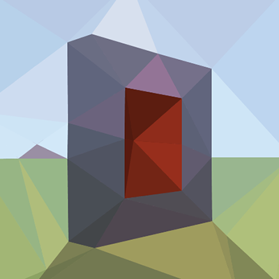

<div align="center">



<h1>Immersive Portals</h1>
<p>Veja o outro lado dos portais e atravesse dimensões pelo próprio portal.</p>
<p><strong>Minecraft 1.21.1 · NeoForge · Java 21</strong></p>

</div>

[Instalação](#instalação) · [Uso](#uso) · [Como funciona](#como-funciona) · [Créditos](#créditos)

## Instalação

Coloque o JAR `build/libs/immersive_portals-6.0.7-all.jar` na pasta `mods/` do cliente e do servidor. Use o JAR com sufixo `-all.jar`, que inclui a dependência Cloth Config.

| Minecraft | Loader | Java | Versão do mod |
| --- | --- | --- | --- |
| 1.21.1 | NeoForge 21.1.228 | 21 | 6.0.7 |

## Uso

Acenda um portal do Nether no mundo de teste e aproxime-se para ver o outro lado pela abertura. A travessia ocorre ao cruzar o plano do portal. No criativo, procure **Portal Wand** para criar, arrastar e copiar portais personalizados. Siga as instruções que a varinha mostra durante a seleção.

## Como funciona

- **Visão e travessia:** o cliente recebe blocos e entidades do destino para renderizar a cena através do portal. Em portais compatíveis, a passagem acontece sem a transição normal de carregamento.
- **Construção:** a varinha marca origem e destino. Portais personalizados podem ter rotação ou escala diferentes. O menu da varinha indica quais ações cabem no modo escolhido.
- **Administração:** aponte para o portal e use a família de comandos `/portal`. Exemplos incluem `/portal set_portal_scale` para escala, `/portal complete_bi_way_portal` para completar a passagem nos dois sentidos e `/portal dimension_stack` para organizar conexões entre dimensões. O preenchimento automático do jogo mostra os argumentos aceitos.
- **Compatibilidade:** as pontes para renderizadores adicionais funcionam conforme as versões disponíveis para o jogo e o loader usados. Use as dependências do mesmo alvo de Minecraft.

### Configuração

O arquivo `config/immersive_portals.json` controla opções como som através de portais, limite de portais renderizados, interação remota entre os mundos do jogo e uso da varinha no sobrevivência. O jogo gera a configuração no primeiro uso.

A variante NeoForge integra **DuPortalLimiter** quando instalado. A ponte consulta as regras de criação e registra portais imersivos do Nether e do Aether.

## Créditos

Projeto original por **qouteall** e colaboradores. Port NeoForge por **Nick1st** e colaboradores do [Immersive Portals Mod for NeoForge](https://github.com/iPortalTeam/ImmersivePortalsModForNeo). Adaptações locais desta variante, incluindo a integração com DuPortalLimiter, por [Arthou](https://github.com/arthoou). Consulte a [licença Apache 2.0](LICENSE).

## Compilar

```bash
java -classpath gradle/wrapper/gradle-wrapper.jar org.gradle.wrapper.GradleWrapperMain build
```

O build inclui a tarefa `jarJar` para gerar o artefato completo.
